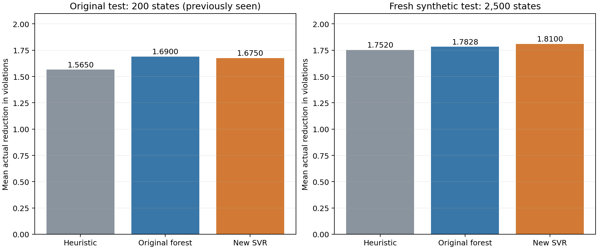

# Comparing more models for variable selection

## What we found

We extended the original experiment to see whether a different model or a wider parameter search could improve on the Random Forest's roughly 8% advantage over the heuristic. The search did not exceed that result on the original 200 test states. The selected model, Support Vector Regression (SVR), achieved a 7.03% advantage there, compared with 7.99% for the original forest.

The result changed on a larger sample of newly generated problems. Across 2,500 fresh states, SVR improved on the heuristic by 3.31%, while the original forest improved on it by 1.76%. SVR therefore performed better than the forest on that new sample, even though neither reproduced the original 8% figure. The percentage gain depends on which problems are tested.

This report covers the optional extension. The main assignment report presents the required Decision Tree and Random Forest comparison.

## Models and settings

We tried 45 configurations across eight model families. All used the same six inputs and the same 160 training instances as the original experiment.

| Model family | Settings explored |
|---|---|
| Decision Tree | Additional depths and larger minimum leaf sizes |
| Random Forest | More trees, different leaf sizes, and feature sampling, alongside the original configuration |
| Extra Trees | Different leaf sizes and feature sampling in a more randomized tree ensemble |
| Histogram Gradient Boosting | Different tree sizes with squared-error, Poisson, and absolute-error losses |
| Gradient Boosting | Different tree depths with squared-error and Huber losses |
| Support Vector Regression | Different regularization strengths and error tolerances |
| K-nearest-neighbor regression | Different neighborhood sizes |
| Ridge regression | A regularized linear reference model |

SVR, KNN, and Ridge used standardized inputs. We fitted that scaling within each training fold, so it did not learn from the validation examples. For histogram boosting, we disabled automatic early stopping to avoid introducing a separate split of individual rows. We added neither training examples nor predictive features during the search.

## Choosing a model

We used four-fold cross-validation, grouping by problem instance. In each fold, the model learned from three groups and predicted the fourth. Keeping whole instances together prevented states from the same constraint problem from appearing in both parts of a fold. Across the four folds, each of the 6,400 training candidates received a prediction from a model that had not trained on its instance. These are out-of-fold predictions, covering 800 states. The grouping seed was 20261106; the membership is recorded in `cv_instance_folds.csv`.

Before searching, we declared two ways to choose a winner. The first addressed the practical question: which model's selected variables gave the highest average actual gain? We broke ties using lower MAE and then the trial ID. The second followed the original assignment's prediction objective: choose the lowest MAE, breaking ties using higher gain and then the trial ID.

Both rules chose the same configuration: a standardization pipeline followed by RBF Support Vector Regression, with `C=1`, `epsilon=0.1`, and `gamma='scale'`. SVR fits a nonlinear relationship between the inputs and improvement while allowing a small tolerance around predictions. Its cross-validation results were:

| Method | Out-of-fold MAE | Mean actual gain per state |
|---|---:|---:|
| Percentage heuristic | Not applicable | 1.67625 |
| Original Random Forest | 0.459019 | 1.68000 |
| Selected SVR | 0.438399 | 1.70875 |

We saved the search rules in `protocol.json` and the selected configuration in `selection_lock.json` before evaluating the extension's test results. The selection file includes a SHA-256 hash of the protocol. We then refit the selected model on all 160 training instances. Although the output files list a selection champion and an MAE champion, these are two labels for the same SVR, not two separate successes. No further tuning followed the test evaluation.

## Test results

| Evaluation set | Method | Mean actual gain | Improvement over heuristic | Candidate MAE |
|---|---|---:|---:|---:|
| Original 200 states | Heuristic | 1.5650 | Reference | Not applicable |
| Original 200 states | Original Random Forest | 1.6900 | 7.99% | 0.436549 |
| Original 200 states | Selected SVR | 1.6750 | 7.03% | 0.413237 |
| Fresh 2,500 states | Heuristic | 1.7520 | Reference | Not applicable |
| Fresh 2,500 states | Original Random Forest | 1.7828 | 1.76% | 0.456370 |
| Fresh 2,500 states | Selected SVR | 1.8100 | 3.31% | 0.437867 |



On the original sample, SVR predicted gains more accurately than the forest but selected moves with a slightly lower average gain. Against the heuristic, SVR recorded 18 wins, 180 ties, and 2 losses. Reducing prediction error was not enough to improve the overall selection result on these states.

On the fresh sample, SVR recorded 149 wins, 2,304 ties, and 47 losses against the heuristic. The forest recorded 152 wins, 2,252 ties, and 96 losses. SVR won slightly less often, but it also made far fewer losing choices. Its mean gain exceeded the forest's by 0.0272 violations per state, about 1.53% of the forest's own average gain on this sample.

## How we checked the result on fresh problems

We generated the fresh data after fixing the model choice. We used the instructor's unchanged `make_instance`, `candidate_features`, and `best_value_mutation` helpers, following the supplied generator's choices of density and tightness. Each new instance again had eight variables, four possible values, and five starting states.

Two independently seeded streams, 2026110601 and 2026110602, each produced 250 instances and 1,250 states. SVR exceeded the original forest's mean gain by 0.0272 violations per state in each stream. Its advantage over the heuristic was 2.94% in the first stream and 3.68% in the second.

To assess uncertainty, we used a paired percentile bootstrap with 10,000 resamples of whole instances. Each resample kept an instance's five states together. The 95% interval for SVR's mean gain above the forest was [0.0152, 0.0400] on the fresh sample. On the original sample, the interval was [-0.0450, 0.0100], around an observed difference of -0.0150. The fresh comparison was therefore more favorable to SVR, while the original comparison left the models close.

These intervals describe variation in the evaluation sample for the fitted models. They do not include all uncertainty from training and searching across configurations. The fresh instances also came from the same synthetic generator, so they do not show how either model would perform on real scheduling or other practical Max-CSP problems.

There is one further limitation: we had already seen the original test results before starting this extension. We did not use that set to rank the 45 candidates, but its new results should still be treated as exploratory. The fresh sample provides a cleaner additional check. It also helps address the risk of choosing a configuration that happens to do well across the training folds.

## Checks and reproducibility

We retained the original data and helpers and used exactly the six original predictor columns. For every evaluated state, we checked the heuristic's selected variable against `heuristic_select` and reconciled each method's gain with the supplied mutation procedure. Both methods started from the original assignment. We also checked the supplied ML evaluation helper on ten states per evaluation set and model to confirm prediction order and tie handling. The refitted original forest reproduced its earlier mean test gain of 1.690.

Run the extension from the repository root with the packages listed in `submission/requirements.txt`:

```bash
python3 experiments/model_search/search.py
python3 experiments/model_search/evaluate.py
python3 experiments/model_search/summarize.py
```

The first script saves the protocol, fold scores, full leaderboard, out-of-fold predictions, selected configurations, and fitted models. The second saves the fresh data and evaluation results. The third rebuilds the comparison figure and restores this report from its editorial source, `report_text.md`. The extension uses scikit-learn and does not require XGBoost, LightGBM, or CatBoost.

## Conclusion

The wider search found a useful alternative, but it did not produce a higher score on the original benchmark. SVR reached 7.03% above the heuristic there, below the forest's 7.99%. On the larger fresh sample, it performed better than the forest and lost to the heuristic less often.

We would present this alongside the main experiment as evidence that model choice and evaluation sample both matter. The original 8% figure describes one test set. The fresh results suggest that SVR is worth further study, with a modest advantage under the supplied generator rather than a guaranteed improvement on every problem.

## Sources

The extension uses the MAAI801 assignment and supplied Max-CSP student package. Search settings and model choices are documented in `protocol.json` and `selection_lock.json`; measured results are in `cv_leaderboard.csv` and `evaluation_summary.json`.
